# 系统架构

目标架构采用“网关协调、原生客户端交互、桌面执行端报告本机事实”。LimeIoT 核心保持平台领域事实源；LimeLink 增加产品客户端与受限桌面适配。已实现的本地产品链路与限制见[实现记录](29-implementation-and-verification.md)；可选云入口和硬件不因此自动获得支持。

[Mermaid 源码](diagrams/system-context.mmd)。实线表示目标主链路，虚线表示后续阶段；当前本地 HTTPS 与 MQTT/mTLS 产品链路已取得局部证据，云核心已消费平台 SDK；云工作台已接入显式授权和路由选择，完整跨网及图中的其他后续路径仍需独立验收。

## 控制台与部署方向

桌面控制台、网关与 Agent 运行时按职责区分，可同机或分开。用户已确认网关支持本机与远程部署的产品目标；当前 Linux/NAS 部署、开发环境运行和未来 macOS/Windows 安装产品分别记录。Agent 运行主机也不由控制台或网关位置推定，详见[Agent 控制台与部署架构](32-agent-console-architecture.md)。

## 组成与职责

| 部件 | 拥有的事实和责任 | 不承担的职责 |
| --- | --- | --- |
| 手机用户客户端 | 用户输入、选中目标、原任务引用、当前界面状态 | 常驻网关、任意桌面操作、后台持续推理 |
| 桌面用户客户端 | 原生工作台、当前用户会话、审阅和本机批准入口 | 自建平台命令账本或凭界面状态授予权限 |
| 桌面执行端 | 本机设备身份、当前能力、操作意图/结果、系统效果观察 | 持有用户所有者会话、扩大模型权限 |
| LimeIoT 网关 | 当前设备/模型/授权、命令账本、规则、事件与恢复 | 由网络 ACK 推断电脑实际效果 |
| 可选控制面 | 已批准的云绑定和受限远程请求 | 自动获得本地执行权或任意 RPC 隧道 |
| 未来硬件端 | 设备输入、显示、播放和本地运行时 | 初期软件发布前提 |

## 三条链路

**控制链路：** 手机/桌面用户客户端通过 HTTPS 调用网关正式工具；网关按设备模型向桌面执行端分发受限动作。执行端通过平台认可的设备通道报告结果。当前通过 `urn:limelink:model:desktop:1` 的 `link.exchange` 动作和独立设备 mTLS 接入。

**观察链路：** 使用已有 HTTP 查询与本地事件通道补充实时呈现。命令结果以原命令查询和证据校验为准；事件丢失后重新读取关注对象，不把通知当完整历史。

**媒体链路：** 录音、图片与音频经受限媒体接口和单独授权流动，不塞入命令事件或用任意 URL 代替媒体身份。流式语音与远程媒体转发需要独立接口验收。

## 部署拓扑

当前已有网关部署以 Linux/NAS 为正式安装基础；目标同时支持本机与远程部署，手机与电脑连接同一授权网关。电脑端的 UI 和执行端可先在同一应用进程组装，但身份、存储与权限保持分离。本机网关的托管、退出与更新需作为安装产品实现并验收。

桌面 App 不隐式启动新的网关。未来在电脑上附带 Linux 虚拟机/容器属于另一种安装产品，须评估运行时依赖、端口、数据、更新和退出，不由 macOS/Windows UI 编译通过来证明。

公网模式采用已批准网关主动出站的控制面连接；现有中继只支持有限设备读写，跨端接续和媒体并未因此自动开放。首期不做多主网关或跨进程分布式总线。

## 复用原则

参考 [SRC-IOT-ARCH、SRC-IOT-COMMANDS、SRC-SHOU-ARCH](evidence/sources.json)。可复用的是合同、SDK 与分层；通用核心留在上游，产品绑定和界面留在本仓库。平台缺少的通用授权/端点能力通过上游变更交付，不能用本产品隐藏后台绕过。
