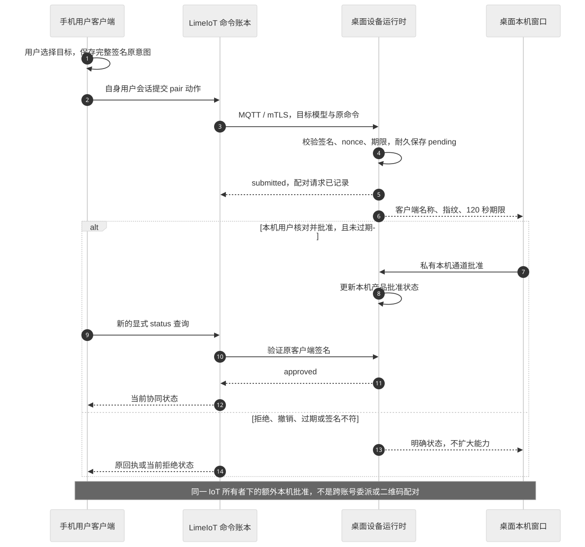

# 配对、身份与授权

当前实现采用“已有 IoT 所有者会话 + 桌面本机批准”。手机用户先有网关访问权，再通过签名产品动作请求 120 秒本机批准。这是同一所有者下的额外协同限制；不提供跨账号委派，也没有独立 `/link/pairing` HTTP 服务。

## 四类关系

| 关系 | 当前实现与边界 |
| --- | --- |
| 用户登录网关/控制面 | 本地客户端使用 HTTPS Cookie 和 CSRF；桌面云授权未接入 |
| 网关绑定控制面 | 复用 IoT 的平台合同；本地产品闭环不要求云绑定 |
| 桌面执行端加入网关 | 管理员注册 Device、安装模型并提供本机 mTLS 配置；App 自助入网未完成 |
| 手机选择电脑协同 | 客户端每个 origin/空间/设备持有独立 P-256 身份；由本机批准后才能提交卡片等产品动作 |

桌面执行端只接收设备证书，不接收用户所有者凭据。手机与电脑工作台各自使用用户会话。模型 Key 留在网关，不进入配对数据。

## 已实现的产品批准

[Mermaid 源码](diagrams/pairing.mmd)。签名字段、预算与命令语义见[实际合同](29-implementation-and-verification.md)。

1. 手机读取指定空间的真实电脑与模型，创建本地签名身份并保存。
2. 用户明确请求配对；客户端冻结目标和完整原意图，保存后调用 IoT `link.exchange` 动作。
3. 网关沿现有命令账本和设备通道派发；运行时验证目标、签名、期限与 nonce，耐久保存 pending，窗口为 120 秒。
4. 电脑本机显示客户端名称与公钥指纹，用户核对手机所示指纹并批准或拒绝。
5. 手机另行查询原命令以及当前 `status`。批准后，卡片等动作仍逐项签名、核对目标及当前本机批准状态。
6. 响应丢失只查询原键；撤销、过期或签名错误明确拒绝。原命令结果不因后来批准而突然重新生效。

已过期、拒绝或撤销的身份可以通过四端工作台中的“重新申请已失效的配对”明确重配。确认后发送同一身份签名的 `pair`，其 payload 增加 `reapply: true`；执行端清除该关系的旧会话与内容，再建立新的 120 秒待批准周期。电脑必须再次批准。正常“请求配对”只返回旧状态，不自动重启；有效 pending 的期限和已批准关系不会因重配请求延长或降级。

重配不恢复旧会话、租约或已取消卡片，原先被拒绝的命令回执保持拒绝；其他客户端的数据不受影响。清除产品当前数据不等于擦除历史回执、WAL 或网关命令。当前没有二维码、短码和跨账号共享，完整真机重配旅程仍待验收。

## 权限与撤销

当前用户网关权限、设备接入权、动作模型、产品批准与单次操作分别校验。本机批准不授予任意文件访问、Shell、持续录音或第三方 App 控制。

撤销后停止后续产品动作，取消待展示卡片并释放该客户端会话写入资格。已经展示的卡片不伪造为从未出现；原回执继续保留。退出用户会话与撤销设备证书是不同操作。

现有本地所有者会话并非按每个产品客户端签发的最小 scope；被批准的身份仍需已有网关用户权限。不能把这个方案描述成网关已原子签发跨账号协同授权。架构取舍见 ADR-013。

## 后续设计边界

若需要跨账号协同、二维码和网关管理关系，应先在 IoT 扩展正式主体、授权和短期一次性引用合同。不能只把所有者 Token 放入二维码或复制给桌面执行端。当前重配只改变产品本机批准状态，沿用既有 `link.exchange`，不引入第二套平台授权。

原生云授权当前限定移动平台，桌面不能直接填写 `macos/windows` 冒充支持。跨网入口必须另有上游合同与四端联合验收。验收范围仍见 TC-003～TC-007；现有局部证据见[实现记录](29-implementation-and-verification.md)。
