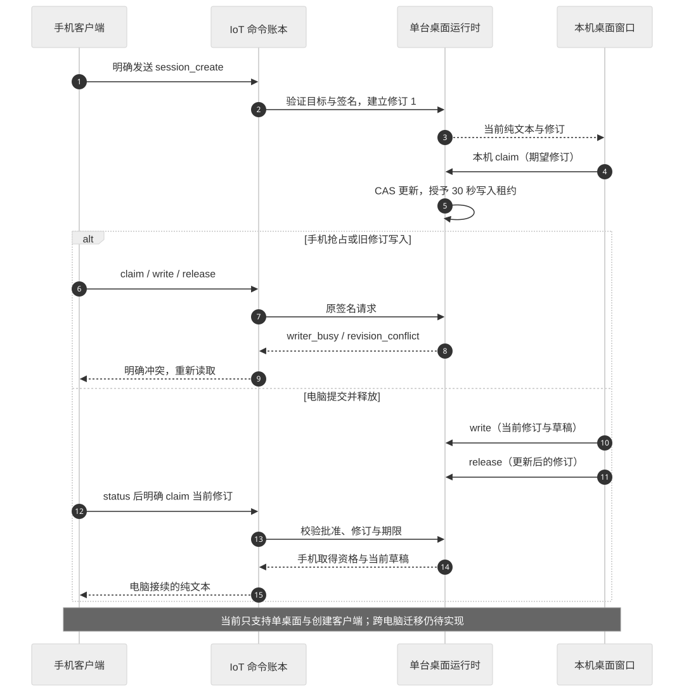

# 跨端会话与协同

当前代码与本文件目标设计的差异，以[实现与验证边界](29-implementation-and-verification.md)为准；未完成路径不构成可用承诺。

首期协同是“同一任务的多端呈现”，后续才增加有限会话接续。共享任务不等于共享全部对话，更不表示手机可以任意操作第三方桌面 App。

## 阶段模型

P2 让两端读取同一任务引用。P3 再增加会话关联、正文选择和活动输入端。会话路由属于产品语义，平台通用原语由网关正式扩展；当前没有既有的接续 API 可直接调用。

[Mermaid 源码](diagrams/handoff.mmd)。生成任务在源端开始后保持原平台任务 ID，接续不会再次启动相同推理或操作。

## 路由与输入仲裁

| 规则 | 原因与处理 |
| --- | --- |
| 输入绑定精确目标和当前 route_revision | 避免排队语音写入用户已切走的会话 |
| 一个会话同一时刻一个活动写入资格 | 防止电脑和手机同时按旧上下文派发 |
| 路由更新采用条件修订 | 旧端提交返回冲突并重新读取，不覆盖新端 |
| 输入资格短期、可撤销 | 休眠、后台和重连不恢复永久写入权 |
| 当前资格只允许定义范围内的新输入 | 不重放旧任务或代批工具权限 |

首期使用网关串行化的条件更新即可；分布式租约和多主路由不在当前范围。设备 MQTT session 与产品 LinkSession 保持独立。

## 上下文共享

默认共享任务阶段、错误类别和结果引用。正文、截图、附件和语音分别由用户选择；目标端必须具有接收资格。共享包绑定来源、会话、截止时间和内容摘要，接收方将其作为不可信数据，不根据正文里的“允许访问”扩大权限。

上下文必须限定条数、字节与保留时间，参数在 P3 合同阶段固定。删除共享正文不删除原命令事实，原任务结果未知时也不能清空引用后重新派发。

## 操作系统边界

桌面可在授权后调用指定原生接口；读取其他 App 的输入框需要逐应用、逐系统验证。手机通常只能可靠控制自身应用及公开系统接口，不能承诺向手机里的所有 AI App 自动注入或发送。

Android 的特定通知能力需要单独用户授权，iOS 不具有任意读取其他 App 通知的通用能力。这些均不作为首期协同前提，也不通过可访问性服务建设任意操控通道。

## 失效与恢复

来源端退出、目标端离线、路由修订变化、共享正文过期或授权撤销都使未提交核对失效。接收不明时查询原接续记录；不能自动选择最近历史会话。TC-017/TC-018 验证竞争和数据隔离。
