# 任务、回执与故障恢复

当前代码与本文件目标设计的差异，以[实现与验证边界](29-implementation-and-verification.md)为准；未完成路径不构成可用承诺。

所有真正设备动作沿 LimeIoT 原命令账本执行，产品任务仅组织旅程和保存关联。本机执行端仍需耐久保存自己的操作意图/观察，以报告真实效果；这不构成另一套平台命令状态机。

[Mermaid 源码](diagrams/task-lifecycle.mmd)。图中的产品步骤对应上游正式状态，不能以此新增未经实现的网关状态。

## 提交边界

提交前冻结 origin、空间、目标、模型修订、operation、期限和原键，保存并回读成功后才发出请求。相同键只能对应相同完整输入；改变目标或正文是新任务，必须先解决与当前未知动作的关系并重新明确发送。

网关的 `action.invoke` 使用 `operation.value` 作为类型化输入。桌面卡片可设计为产品动作 `link.show_card`，但名称、输入/输出、长度和完成范围仍是候选，需正式模型与端侧实现后才能声明可用。

## 完成范围

| 证据 | 可以表示 | 不足以表示 |
| --- | --- | --- |
| HTTP 202 / accepted | 网关受理 | 已送达电脑 |
| dispatched / MQTT ACK | 已进入指定传输阶段 | 已执行系统动作 |
| action_result + submitted | 输入提交给目标系统 | 窗口显示、用户已读 |
| action_result + observed | 已观察到模型所定义效果 | 模型没有声明的其他效果 |
| unknown / 结果无法绑定 | 尚不能确认 | 可以无风险再执行一次 |

对于卡片，端侧应区分内容记录已保存与界面已呈现。窗口尚未可用时不提前声称 observed；若暂存和显示之间崩溃，按持久记录核实或保留未知。

## 故障处理矩阵

| 故障点 | 处理 |
| --- | --- |
| 提交前本机落盘失败 | 零发送，保留可解释错误 |
| 提交响应丢失 | 查询原键/command_id；404 不能证明旧请求永远不会到达 |
| 网关已受理、电脑离线 | 遵守原期限，首期不增加跨端离线补发队列 |
| 端侧操作后未写回结果 | 使用原端侧意图核实；无法证明时 unknown |
| 双端同时读取 | 展示同一原结果，禁止因页面恢复创建新命令 |
| 网关或客户端重启 | 恢复引用、重新认证、只读核实原任务 |
| 事件游标过旧 | 读取关注对象当前状态，显示事件历史缺口 |
| 已撤销后迟到回执 | 可保留历史结果，不能恢复执行权 |

## 取消与截止

取消未提交草稿不发送命令；停止本地等待只取消订阅；真正取消要有执行端能力与确认。已提交动作不能由关闭窗口撤回。当前平台没有适用于任意桌面任务的通用远程抢占取消，不得把产品按钮当成已有后端能力。

上游命令期限目前最多受理后 30 秒，不通过重复查询或连接恢复续期。长时间 AI 作业或文件任务需要其专用任务合同，不塞进短期设备动作。

来源：[SRC-IOT-COMMANDS、SRC-IOT-EVENTS](evidence/sources.json)。TC-008～TC-015 覆盖主要失败边界。
