# 仓库、模块与工程规范

LimeLink 是独立产品 monorepo，参考 Gootuan 的产品归属和显式依赖，参考 Shou 的平台原生分层。多仓工作区不是一个产品仓库。



[Mermaid 源码](diagrams/repository-boundaries.mmd)。参考关系不产生构建依赖。

## 当前与目标目录

当前包含四端原生工程、Rust 执行端、固定 SDK 导出、联合检查，以及 docs、视觉原件和 site 宣传站。各目录已有真实消费者；具体构建和验证范围见[构建试用](30-build-and-local-trial.md)：

```text
limelink/
  apps/macos/          原生桌面入口与 macOS UI
  apps/windows/        WinUI App、应用服务和系统适配
  apps/ios/            产品手机入口与 Xcode 项目
  apps/android/        Compose 产品入口与固定 Gradle Wrapper
  packages/            真正被多个入口消费的产品值类型/合同
  contracts/           已版本化、可校验的产品合同
  runtime/             MQTT 设备运行时、本机存储与协同检查
  tools/               实际需要的生成/构建/取证工具
  docs/                本轮已有的产品与工程文档
  site/                已新增的独立静态宣传站
  output/imagegen/     本轮模型生成图原件
  .dev/                忽略提交的缓存、密钥夹具、构建与测试状态
```

## 所有权

| 内容 | 仓库 |
| --- | --- |
| 通用物模型、授权、命令、事件、网关和平台 SDK | LimeIoT |
| 桌面执行端系统行为、协同选择、产品接续和 UI | LimeLink |
| 咕团角色、运动、玩具内容与固件 | Gootuan；本产品不依赖 |
| 系统清理和软件管理领域 | Shou；本产品仅参考组织方式 |

产品合同不复制平台 Schema 成为第二个可修改来源；可以固定上游文件/包引用或生成不可手改的绑定。共享资源遵循单一事实源和确定性生成，生成结果需 `--check` 类检查。

## 构建与依赖

macOS/iOS 用 SwiftPM/Xcode，Windows 用原生 .NET 工程，Android 用 Gradle。工具链在有实际消费者时固定；不为统一命令把原生工程改造成 npm 包。顶层聚合脚本只调度已有任务，不把跳过的平台记为通过。

依赖通过版本化包、SDK 制品或明确路径消费。开发路径须由参数传入并检查来源修订；不得默认读取 `../iot`、建立隐式私有仓库依赖或复制网关源代码。上游未提交扩展必须单独标记，不能冒充发布标签内容。

## 代码与变更

按真实职责拆分用例与系统适配，UI 不处理授权策略；重复出现再抽取共享，不提前建立通用插件层。各平台独立实现必须消费同一正反测试向量，确保数据与恢复语义一致。

变更说明应列出需求、合同、消费者、测试和证据。文档与运行行为同步；新实现不得仅修改 status.json 宣称完成。用户已要求实现完成后提交并推送 v0.1.0；当前可提交可审阅的阶段改动，Tag 必须满足最终放行。宣传站独立部署，正式签名和商店渠道仍需相应发行条件。
