# Agent 控制台与部署架构

2026-11-05 用户明确：电脑端是网关控制台，网关可安装在本机或远程；最终产品参考 HachimoDock，支持 AI Agent，手机与电脑传递内容仅为基础能力。本文件记录完整定位、目标与交付顺序。首个 Agent 切片已取得局部证据，安装管理、多端完整旅程和硬件仍待实现验收。

[Mermaid 源码](diagrams/agent-console.mmd)。这是目标部署关系。首个 Codex 运行时和 macOS 本机批准已取得局部证据，详见[首个 Agent 执行闭环](33-agent-execution.md)；未来硬件尚未验收。

## 产品定位

LimeLink 是面向个人的跨端 AI Agent 控制台与交互终端。桌面、手机和未来硬件共同查看任务、输入文字或语音、确认操作并接收结果；网关连接设备、提供授权和受控工具。桌面界面保持 Shou 的原生布局、渐变、设置入口与简洁文案。

| 部件 | 职责 | 安装位置 |
| --- | --- | --- |
| 桌面控制台 | 网关连接、Agent/会话选择、任务、设备、形象与设置 | 用户电脑；无需与网关同机 |
| 手机客户端 | 输入、任务跟进、确认和通知；恢复同一会话 | 用户手机 |
| LimeIoT 网关 | 设备接入、物模型、工具授权、命令事实与结果查询 | 本机或远程机器，目标位置与当前支持范围分别验收 |
| Agent 运行时 | 调用模型、使用允许的工具、维持 Agent 会话和任务进度 | 本机或远程执行主机；不与控制台位置绑定 |
| 主机适配器 | 连接该主机上的外部 Agent 和系统能力，返回真实观测 | 能力所属的电脑/服务器；远程网关不能直接访问本机应用 |
| 硬件终端 | 形象、任务状态、语音/按键和有界组件 | 后续独立硬件；无硬件时软件功能仍可用 |

控制台、网关、Agent 运行时是三个角色，可同机，也可分开。客户端统一经过网关的已认证入口发起与恢复任务，网关按当前授权路由到执行主机；不因远程 Agent 存在而另外公开一个绕过网关的控制入口。网关与 Agent 可以由同一安装产品管理，代码和身份仍按职责区分，不为此预建一套重复的平台服务。

## 本机与远程

| 模式 | 用户体验目标 | 生命周期 |
| --- | --- | --- |
| 本机部署 | 控制台识别已安装的网关；未安装时按平台提供安装流程；安装后直接选择 | 运行状态、启动/停止、版本、更新和卸载可见；关窗与退出行为需明确 |
| 局域网远程 | 自动发现 NAS/服务器上的网关，选择后完成认证 | 控制台关闭不停止远程网关；公告消失不撤销既有会话 |
| 跨网远程 | 恢复已保存且授权的云/远程连接 | 使用既有云授权或可达 HTTPS，mDNS 不跨互联网 |

“本机部署”是已确认产品目标。当前有原生控制台、Linux/NAS 部署，以及通过隔离旅程的 macOS 宿主 Linux ARM64 离线包与 Rust 部署辅助程序，见[部署证据](evidence/local-gateway-installation.json)。macOS 已提供统一的本机/远程安装管理入口，共用一个本机控制器，实际窗口见[入口复验](evidence/gateway-management-macos-ui.json)。辅助程序沿正式平台流程准备当前电脑的设备证书，网关由 Docker 托管；明确启动后，退出控制台不停止网关，须明确停止。系统信任、Windows、完整安装中断恢复、正式更新及卸载仍未完成，开发包不代表正式一键安装产品。桌面执行端的 MQTT 设备配置与网关部署配置分别管理。

远程支持普通 Linux 原生部署，不要求 Docker。安装引导分别收集网关入口、SSH 主机、管理员用户名、端口与包位置；SSH 管理员和运行账号分离，服务使用专用非 root 账号，内部 HTTP/明文 MQTT 只监听回环。用户授权服务器已通过 17 项 systemd、回环 TLS、登录、设备 mTLS、私钥隔离及身份保留检查，见[普通版本证据](evidence/native-gateway-server.json)。公网仍需 DNS、受信证书、独立 Nginx 站点和安全组；内网需明确客户端证书信任。生成引导不代表远程服务已部署或公网已可用。

网关发现使用上游 `_limeiot._tcp.local.` 合同。发现只给出候选入口，用户认证后读取真实空间和设备。手填地址为备用，JSON 导入为管理员维护入口。网关发现、主机安装发现、外部 Agent 发现和首次设备入网分别实现，不能用一个“发现成功”状态代替。

当前 macOS 已有“设置 → 本机助手”，可在已有设备身份上配置 Codex、目录、权限与设备工具，保存后重新连接执行端。自动查找会排除低于适配基线或缺少 App Server 命令的程序；原生设置与真实设备任务的证据见[首个 Agent 执行闭环](33-agent-execution.md)。该入口不承担设备注册或网关安装。

Windows 已实现对应设置与执行端生命周期源码，并通过 .NET 核心和 WinUI C# 类型检查；文件 ACL、XAML 构建、设置窗口和退出行为仍需 Windows 验收，见[Windows 设置检查](evidence/agent-settings-windows-core.json)。控制台设置保持用户会话与执行端设备身份分离，只编辑原设备配置中的 Agent 字段。

## AI Agent 能力

| 能力 | 目标行为 | 交付边界 |
| --- | --- | --- |
| 外部 Agent 接入 | 显示可用 Agent、会话、思考/执行/等待/完成状态，向选定会话提交输入 | 各适配器声明实际支持的能力与版本；检测到进程不代表可以写入会话 |
| LimeLink 内的 Agent | 用户在控制台或手机发起任务，Agent 使用允许的模型和网关工具完成任务 | 需要独立 Agent 会话、工具调用与恢复实现；已有 AI 整理草稿仅为模型调用 |
| 设备工具 | Agent 查询设备、提出操作，按当前授权执行并读取结果 | 工具能力与命令事实归 LimeIoT；产品不另建命令账本 |
| 主机工具 | 连接本机应用、文件或其他明确授权的系统能力 | 每项由所属主机适配器提供；不由网关位置隐式获得权限 |
| 多端会话 | 手机开始输入，桌面跟进，硬件显示相同任务进度 | 会话固定网关、Agent、执行主机及目标；不按“最近使用”猜测会话 |
| 语音与形象 | 语音形成草稿或当前会话输入，角色反馈任务状态 | 模型调用、发送、工具批准分别处理；形象动画不能替代任务结果 |
| 小组件 | 展示待办、电脑状态、设备与 Agent 任务 | 后续有界数据与组件合同；不提前承诺应用商店或任意脚本 |

首个 Agent 适配器应先完成“发现可用 Agent → 选择明确会话 → 提交一次输入 → 查看真实进度与结果 → 断线恢复原任务”的闭环。支持状态观察、列举会话、新建、输入、流式事件、中断、权限请求和恢复是不同能力，不能用一个 `supported` 开关表示全部兼容。未实现的能力不显示可用按钮。

任务引用至少需要区分：网关、空间、Agent、执行主机、会话、一次运行及相关工具命令。Agent 运行记录管理会话和生成进度，LimeIoT 命令记录管理设备操作；两者用引用关联。流式连接断开不代表 Agent 已停；取消只有适配器确认了对应动作才更新为已停止。工具写入结果未知时查询原命令，不能再次执行以换取明确状态。

## 界面结构

| 入口 | 用户任务 |
| --- | --- |
| 概览 | 当前网关、进行中的 Agent 任务、需要处理的事项 |
| 助手 | 选 Agent 和会话、文字/语音输入、查看回复及工具步骤 |
| 任务 | 运行进度、等待确认、结果、原任务恢复 |
| 设备 | 网关下的电脑、手机和 IoT 设备，真实能力与在线状态 |
| 协同 | 发送/接收内容、共同编辑；作为功能区保留 |
| 设置 | 网关部署与连接、模型服务、适配器、权限、外观、诊断 |

这是目标信息架构，不一次性创建空标签页。先把已有连接和协同能力放到正确位置，随后按真实 Agent 切片添加助手与任务入口。首页不堆功能说明，不再以“手机发送，电脑接收”概括整个产品。宣传站在实际能力交付后同步，不能把目标功能放成已可用下载承诺。

## 与 HachimoDock 的关系

本次读取 HEAD `5e2dbdacb7beda88843b2182ae98c7f0c5060721`，工作树干净，文件摘要见[研究快照](evidence/agent-console-reference.json)。参考其 Agent 状态、语音草稿、会话适配、角色与硬件反馈，结合 LimeIoT 的网络设备与授权能力。实现仍保持 LimeLink 的原生客户端与网关分层；不复制其源码、素材、USB 拓扑或私有应用接口。

其 `agent-session-bus` 将不同 Agent 写入路径封装到适配器，适合参考职责划分。源码默认最近会话的策略与兼容审计要求存在不同适用路径，LimeLink 采用明确目标引用；其 cancel 接口文档说明只关闭事件管道，不能将其作为真正停止 Agent 的实现。参考工程测试不计入本产品验收。

## 分阶段交付

1. **连接基础**：真实自动发现、保存连接、自助设备入网；区分控制台与接收端。当前 Apple 发现与 NAS 公告已进入实现，平台覆盖与实测单独记录。
2. **安装与运行**：本机网关安装、启动/停止、日志和更新；远程连接独立于本机服务生命周期。先验证一个宿主平台，不用全局依赖安装掩盖发行缺口。
3. **Agent 闭环**：一个实际适配器、固定会话输入、真实事件与原运行恢复；同时验证主机位置与手机入口。不能用 mock Agent 或 AI 草稿代替。
4. **设备任务**：Agent 调用已授权的 IoT 工具，串联执行与证据；模型运行、工具批准及设备结果分别可见。
5. **多模态与硬件**：语音闭环、形象反馈、有界小组件和独立硬件样机，逐项验收。

`v0.1.0` 仍待完整产品出口验收。此次方向确认不是放行，也不将上述阶段自动标为已实现。
