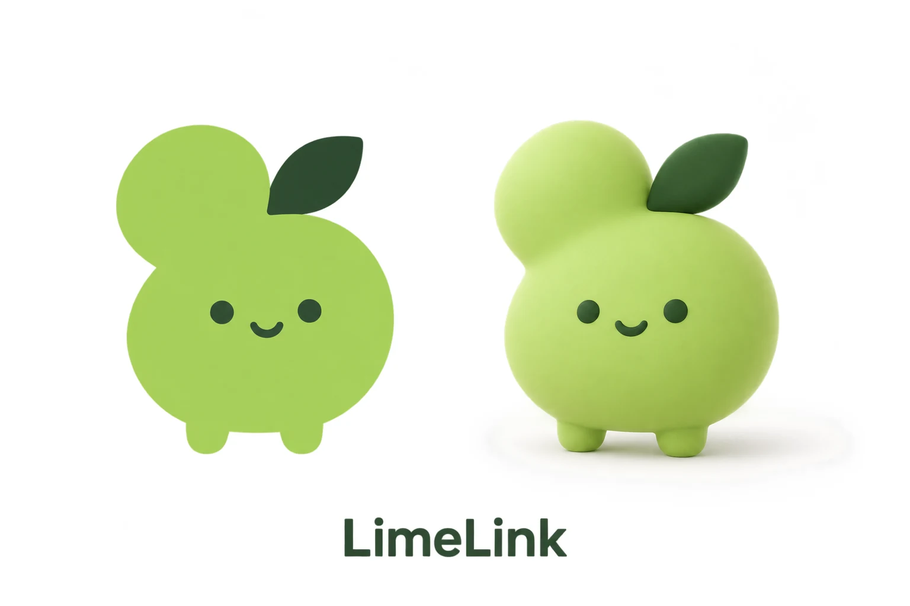

# 品牌识别与参考取舍

LimeLink 的核心体验是手机、电脑通过网关建立明确的协作关系。视觉需要在 24 像素图标中易认，也能延伸为桌面陪伴角色和未来产品外观。

## 这一版的选择

选择第二轮探索中的不对称双瓣青柠，而不是独立的链条图案。小上瓣与大下瓣相接，呼应两个端点；叶片强化 Lime 的联想；低位点眼和微笑形成陪伴感。两只短脚让平面标志可以自然落到桌面上，减少物化时重新设计角色的成本。

这是一种设计解释，不是用户已经理解该隐喻的研究结果。待开展小尺寸识别、去色识别、名称记忆和类似商标排查，再决定是否定版。柠柠是本轮设计工作名，不与柠联混为正式注册名称。

## 借鉴方法

京东机器狗、天猫精灵、小米等是用户指定的参照方向。本轮提炼的是“符号 → 角色 → 材质 → 实物 → 场景”的工作方法，没有收录其标志、角色素材或临摹其轮廓。这里也不把这些品牌的完整官方设计规范视为已经研究、授权或核验。

| 参照方向 | 可学习的方法 | LimeLink 的落点 |
| --- | --- | --- |
| 京东机器狗式角色化 | 固定可辨识轮廓，角色在不同载体保持身份 | 双瓣、叶片、低位脸固定，表情和材质可变 |
| 天猫精灵式软硬件识别 | 软件入口、实体表面和空间使用保持一致 | 图标、App 空状态、显示终端使用同一角色 |
| 小米等品牌的简洁表达 | 降低基本元素数量，控制缩小和单色应用 | 两个主色、单一轮廓、独立小尺寸模板 |
| Gootuan 的母版方法 | 先选母版，后续用图像编辑继承，保留生成记录 | 02 探索 → 03 标志 / 04 角色 → 05 硬件 → 生活场景 |

Gootuan 的母版组织和证据方法有实际仓库依据，来源为 [SRC-GOOTUAN-VISUAL](../evidence/sources.json)。LimeLink 没有使用其球形、天线、轮子、相机或角色素材。

## 身份不变量

正视时，上瓣偏左，叶片在右上；大下瓣承载低位的两只点眼和微笑；只有两只短脚，没有手臂。角色不添加猫耳、犬鼻、兔耳、轮子、天线等会改变身份的结构。转到背面不画脸，转向不通过镜像修改叶片关系。

平面版用于标志和小尺寸入口；立体硅胶/毛绒版用于品牌展示；深色面屏版用于未来硬件概念。三者共享轮廓，但屏幕、材料和接口不属于平面标志本身。

## 待冻结事项

首轮生成图的渐变、轻微纹理和背景 alpha 不作为 VI 标准色。可交付标志已从母版提取轮廓并转换为固定双色，见 [VI 规范](vi-spec.md)。生成场景保留自然光变化，不能从其照片像素反推壳体色样。

商标、角色名称、域名、外观相似性和可商业使用条件尚未作专门审查。模型服务的权利条款也需在正式商业投放前确认；本仓库的代码许可证不会自动替代这些条件。
