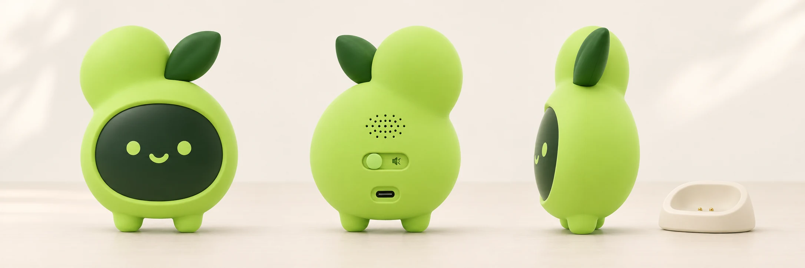

# 角色物化与未来硬件

未来硬件应延伸既有的多端协作体验。当前只有外观概念、场景假设和立项问题，没有工程结构、BOM、CAD、样机、尺寸冻结或量产参数。正式路线见[未来硬件终端](../23-hardware-terminal-roadmap.md)。

## 三种物化层次

| 层次 | 场景 | 当前产物 | 后续门槛 |
| --- | --- | --- | --- |
| 品牌物件 | 贴纸、徽章、钥匙扣、毛绒、硅胶摆件 | 材质与外观效果图 | 版权/商标、材料、工艺、结构和打样 |
| 桌面显示伴侣 | 有界卡片、专注、提醒、状态 | 带深色面屏的角色母版和生活场景 | 场景价值、显示功耗、可读性、输入输出与预算 |
| 协同终端 | 经网关关联手机和电脑 | 网络与使用情景设计 | 身份、能力、任务回执、离线恢复和实际硬件验证 |

图中的壳体、屏幕、扬声孔、滑块、接口和底座只表达功能位置与设计意图。图像模型对背部和侧面可能不严格满足装配关系，因此不能直接量图开模或视为可装配结构。没有摄像头是当前概念选择；是否需要麦克风、扬声器、触摸和物理静音必须分别论证。

## 场景与价值假设

本轮绘制办公联动、学习专注、床头静音、家庭留言、会议分享、便携差旅、可访问提醒和离线恢复。各场景有独立图片、提示词、所依赖母版和阶段标识，见[图册](scene-gallery.md)。

这些场景用于讨论“为什么需要多一个实体”。它们不是自动新增的 PRD 功能：床头场景不承诺健康监测，家庭场景不承诺防水或控制家电，会议场景不承诺录音转写，便携场景不承诺内置电池或蜂窝网络，可访问场景不构成医疗或辅助器械认证。

## 保持一致的外观规则

保留双瓣、叶片、低位面部与固定短脚。显示终端的脸在下瓣深色屏幕内，面屏上的卡片与表情占用必须由实际显示面积验证。青柠壳体为方向，不能用照片中的颜色替代材料色样。

屏幕大小、可视角、叶片易损点、底部稳定性、线缆拉扯、滑块可达性、散热、声腔、接缝和清洁是工程问题。本轮没有用“可爱”替代这些验证。若双瓣结构导致显示面积或装配成本不合理，应保留品牌角色、重新评估实体结构。

## 软件先行

先用电脑和手机验证协同任务，再判断实体是否能降低打断、提高可见性或改善特定环境体验。样机立项时明确首个场景、供电方式、端侧与网关职责、权限、离线语义、预算和退出条件。当前图片不是采购、开模或生产授权。
