# 完整场景图册

本轮 28 张原始生成图逐张列出。所有屏幕为设计效果，硬件为未来外观概念；图中路径不作为协议图。准确职责以[系统架构](../05-system-architecture.md)为准。角色与跨端资源见[品牌入口](README.md)。

[查看全部缩略图](contact-sheet.jpg) · [查看生成记录](image-generation.json)

## 场景清单

| 编号 | 场景 | 阶段 |
| --- | --- | --- |
| 01 | [Flare 标志与物化探索](#图-01) | P0 |
| 02 | [Sunburst 标志与物化探索](#图-02) | P0 |
| 03 | [平面标志母版](#图-03) | P0 |
| 04 | [角色四视图母版](#图-04) | P0 |
| 05 | [未来终端外观母版](#图-05) | P5 |
| 06 | [角色表情与状态](#图-06) | P0 |
| 07 | [四端品牌应用](#图-07) | P1/P2 |
| 08 | [VI 文具与包装](#图-08) | P0 |
| 09 | [角色物化与周边](#图-09) | P5-concept |
| 10 | [手机电脑网关与未来硬件全景](#图-10) | P2/P5 |
| 11 | [手机向电脑发送卡片](#图-11) | P2 |
| 12 | [扫码配对与本机确认](#图-12) | P2 |
| 13 | [同一回执与断线恢复](#图-13) | P2 |
| 14 | [手机与电脑会话接续](#图-14) | P3 |
| 15 | [多台电脑明确选择目标](#图-15) | P3-exploration |
| 16 | [语音先成草稿再发送](#图-16) | P4 |
| 17 | [电脑工作台与有界组件](#图-17) | P4 |
| 18 | [未来受限跨网协同](#图-18) | P3 |
| 19 | [网关在家庭 Linux NAS 的部署](#图-19) | P2 |
| 20 | [撤销授权与私密空间](#图-20) | P2 |
| 21 | [桌面硬件与手机电脑联动](#图-21) | P5 |
| 22 | [学习与专注陪伴](#图-22) | P5-exploration |
| 23 | [床头提醒与静音](#图-23) | P5-exploration |
| 24 | [家庭留言与厨房餐桌](#图-24) | P5-exploration |
| 25 | [会议桌协同与显式分享](#图-25) | P5-exploration |
| 26 | [差旅与便携场景候选](#图-26) | P5-exploration |
| 27 | [大字号与可访问提醒](#图-27) | P5-exploration |
| 28 | [硬件离线与恢复状态](#图-28) | P5-exploration |

## 图 01

**Flare 标志与物化探索** · P0 · 请求模型 gpt-image-2.5-flare

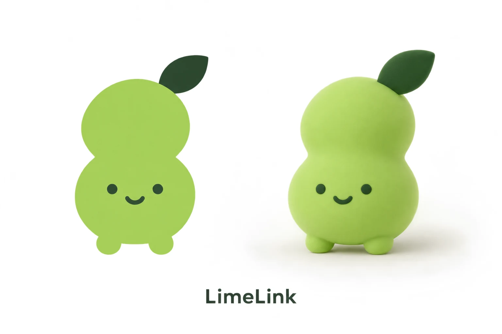

[原始 PNG](../../output/imagegen/01-logo-flare.png) · [完整提示词](prompts/01-logo-flare.txt)

设计用途：品牌方向与身份一致性评审。

## 图 02

**Sunburst 标志与物化探索** · P0 · 请求模型 gpt-image-2.5-sunburst

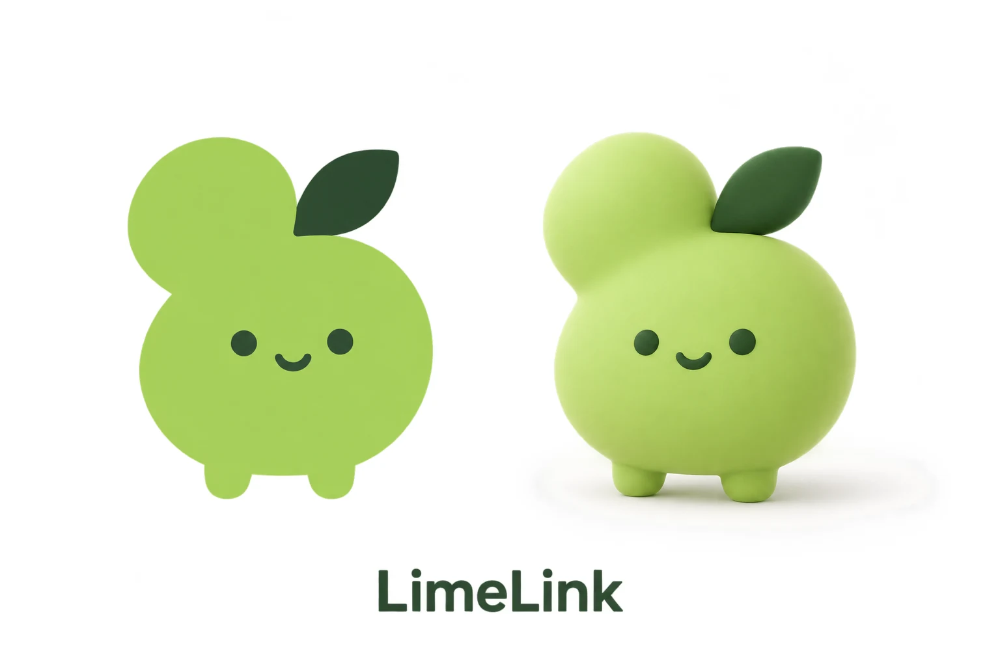

[原始 PNG](../../output/imagegen/02-logo-sunburst.png) · [完整提示词](prompts/02-logo-sunburst.txt)

设计用途：品牌方向与身份一致性评审。

## 图 03

**平面标志母版** · P0 · 请求模型 gpt-image-2.5-sunburst

[原始 PNG](../../output/imagegen/03-mark-master.png) · [完整提示词](prompts/03-mark-master.txt)

设计用途：品牌方向与身份一致性评审。

## 图 04

**角色四视图母版** · P0 · 请求模型 gpt-image-2.5-flare

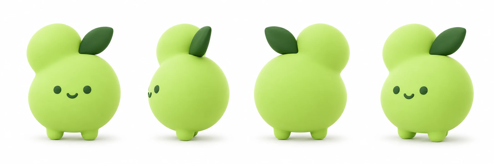

[原始 PNG](../../output/imagegen/04-mascot-turnaround.png) · [完整提示词](prompts/04-mascot-turnaround.txt)

设计用途：品牌方向与身份一致性评审。

## 图 05

**未来终端外观母版** · P5 · 请求模型 gpt-image-2.5-flare

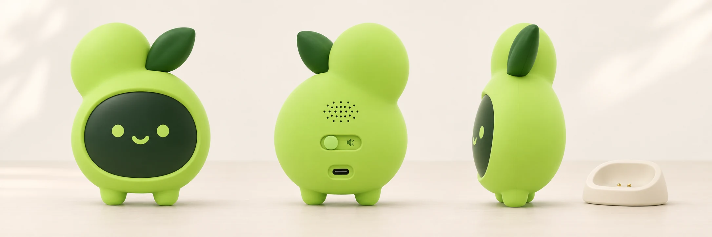

[原始 PNG](../../output/imagegen/05-hardware-master.png) · [完整提示词](prompts/05-hardware-master.txt)

设计用途：品牌方向与身份一致性评审。

## 图 06

**角色表情与状态** · P0 · 请求模型 gpt-image-2.5-sunburst

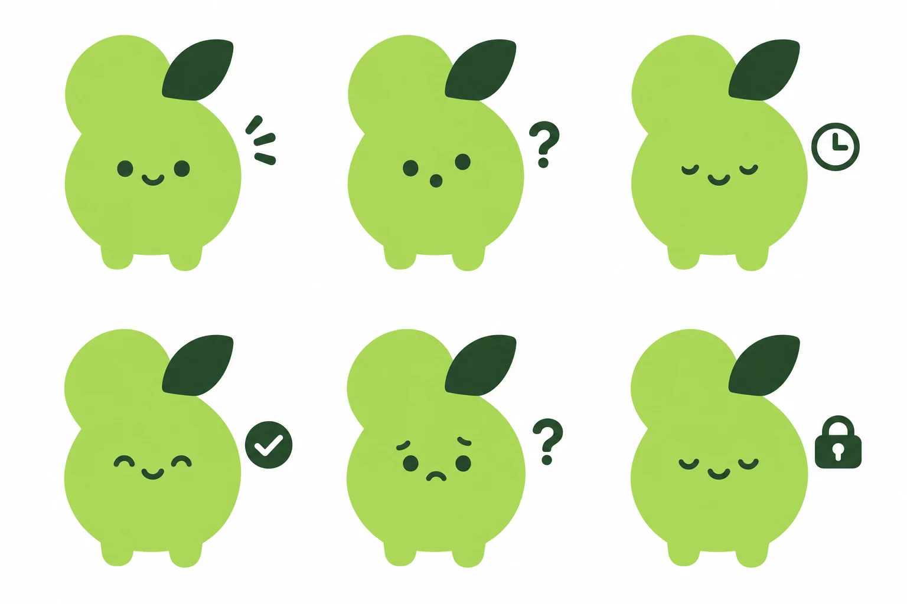

[原始 PNG](../../output/imagegen/06-emotions.png) · [完整提示词](prompts/06-emotions.txt)

设计用途：品牌方向与身份一致性评审。

## 图 07

**四端品牌应用** · P1/P2 · 请求模型 gpt-image-2.5-sunburst

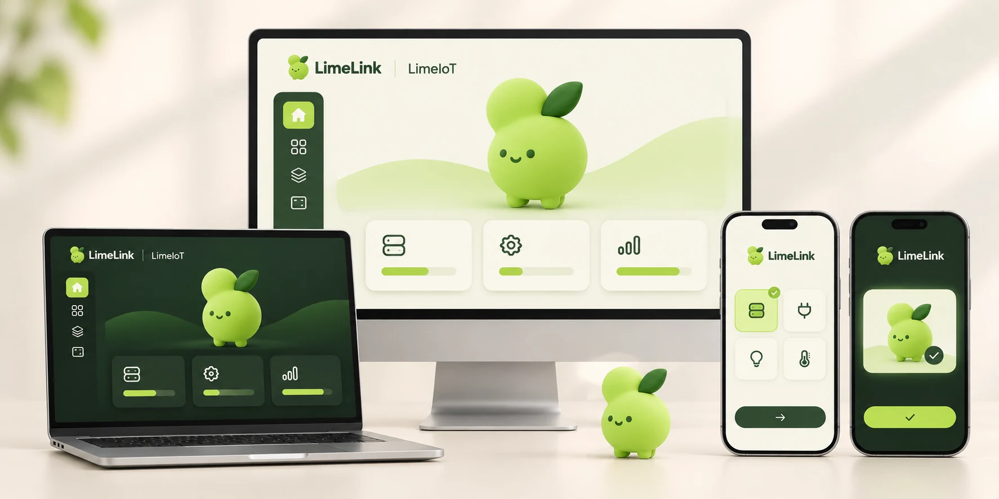

[原始 PNG](../../output/imagegen/07-four-platforms.png) · [完整提示词](prompts/07-four-platforms.txt)

设计用途：品牌方向与身份一致性评审。

## 图 08

**VI 文具与包装** · P0 · 请求模型 gpt-image-2.5-sunburst

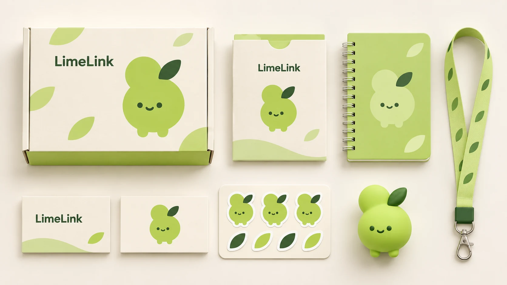

[原始 PNG](../../output/imagegen/08-vi-stationery.png) · [完整提示词](prompts/08-vi-stationery.txt)

设计用途：品牌方向与身份一致性评审。

## 图 09

**角色物化与周边** · P5-concept · 请求模型 gpt-image-2.5-flare

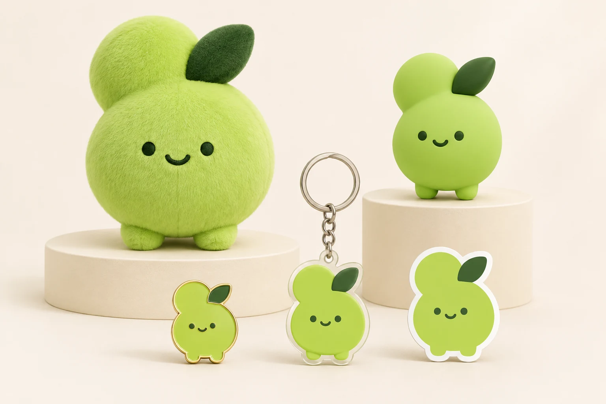

[原始 PNG](../../output/imagegen/09-physical-merch.png) · [完整提示词](prompts/09-physical-merch.txt)

设计用途：品牌方向与身份一致性评审。

## 图 10

**手机电脑网关与未来硬件全景** · P2/P5 · 请求模型 gpt-image-2.5-flare

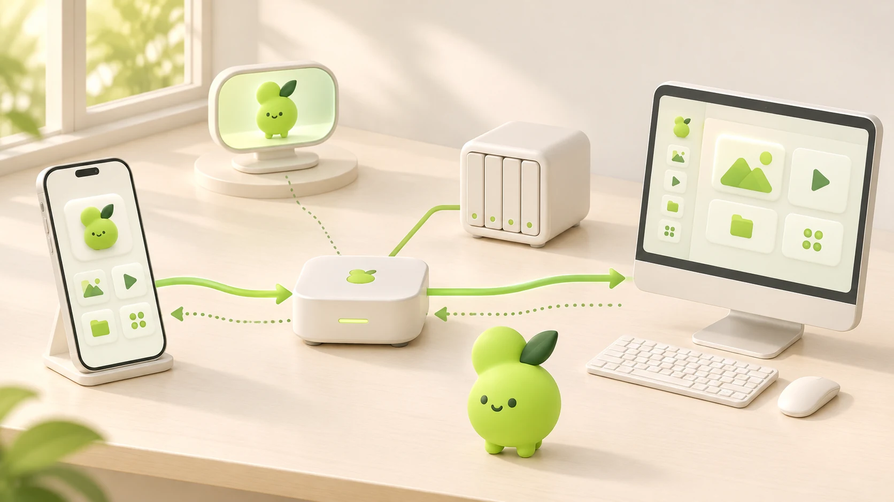

[原始 PNG](../../output/imagegen/10-ecosystem.png) · [完整提示词](prompts/10-ecosystem.txt)

设计用途：软件/网关目标体验讨论；尚无产品运行证据。

## 图 11

**手机向电脑发送卡片** · P2 · 请求模型 gpt-image-2.5-flare

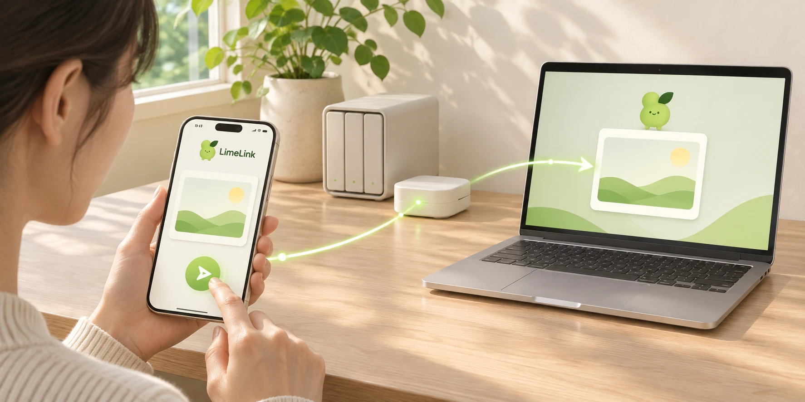

[原始 PNG](../../output/imagegen/11-phone-pc-card.png) · [完整提示词](prompts/11-phone-pc-card.txt)

设计用途：软件/网关目标体验讨论；尚无产品运行证据。

## 图 12

**扫码配对与本机确认** · P2 · 请求模型 gpt-image-2.5-sunburst

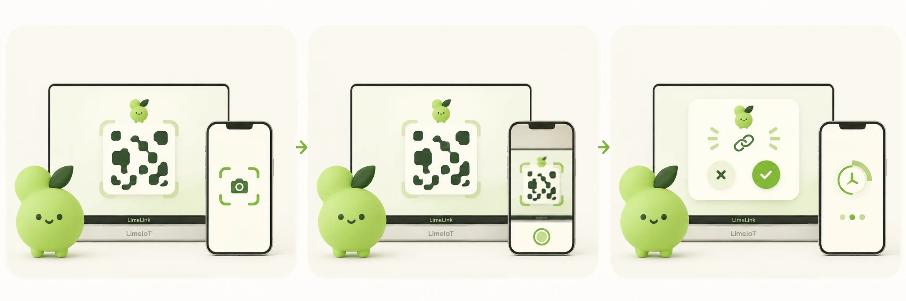

[原始 PNG](../../output/imagegen/12-pairing.png) · [完整提示词](prompts/12-pairing.txt)

设计用途：软件/网关目标体验讨论；尚无产品运行证据。

## 图 13

**同一回执与断线恢复** · P2 · 请求模型 gpt-image-2.5-sunburst

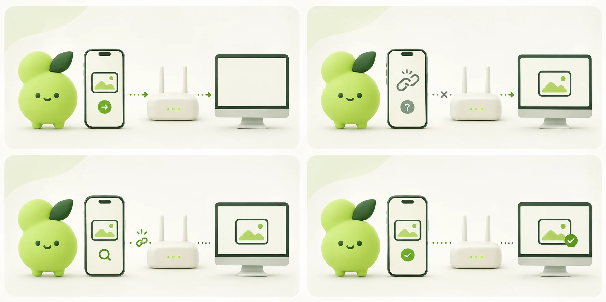

[原始 PNG](../../output/imagegen/13-receipt-recovery.png) · [完整提示词](prompts/13-receipt-recovery.txt)

设计用途：软件/网关目标体验讨论；尚无产品运行证据。

## 图 14

**手机与电脑会话接续** · P3 · 请求模型 gpt-image-2.5-sunburst

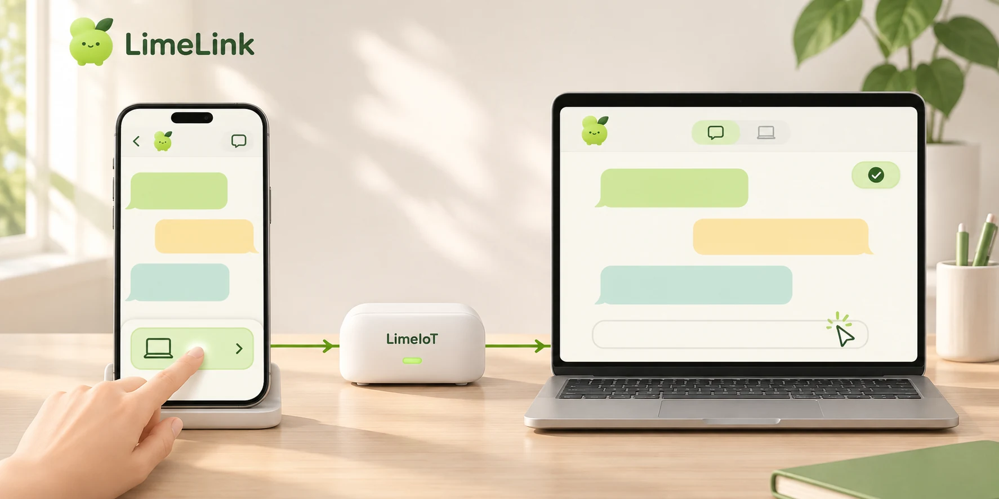

[原始 PNG](../../output/imagegen/14-session-handoff.png) · [完整提示词](prompts/14-session-handoff.txt)

设计用途：软件/网关目标体验讨论；尚无产品运行证据。

## 图 15

**多台电脑明确选择目标** · P3-exploration · 请求模型 gpt-image-2.5-flare

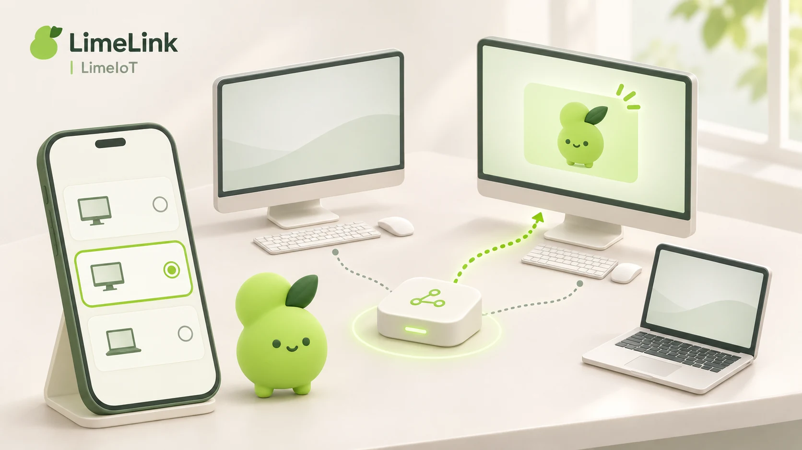

[原始 PNG](../../output/imagegen/15-target-selection.png) · [完整提示词](prompts/15-target-selection.txt)

设计用途：软件/网关目标体验讨论；尚无产品运行证据。

## 图 16

**语音先成草稿再发送** · P4 · 请求模型 gpt-image-2.5-sunburst

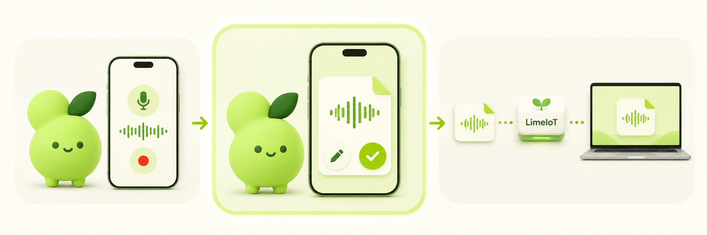

[原始 PNG](../../output/imagegen/16-voice-draft.png) · [完整提示词](prompts/16-voice-draft.txt)

设计用途：软件/网关目标体验讨论；尚无产品运行证据。

## 图 17

**电脑工作台与有界组件** · P4 · 请求模型 gpt-image-2.5-sunburst

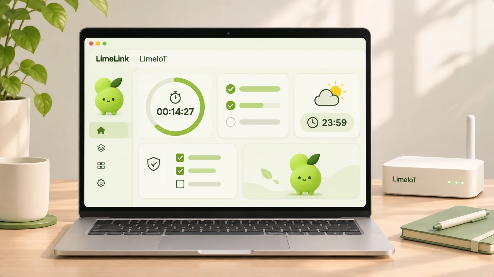

[原始 PNG](../../output/imagegen/17-widgets.png) · [完整提示词](prompts/17-widgets.txt)

设计用途：软件/网关目标体验讨论；尚无产品运行证据。

## 图 18

**未来受限跨网协同** · P3 · 请求模型 gpt-image-2.5-flare

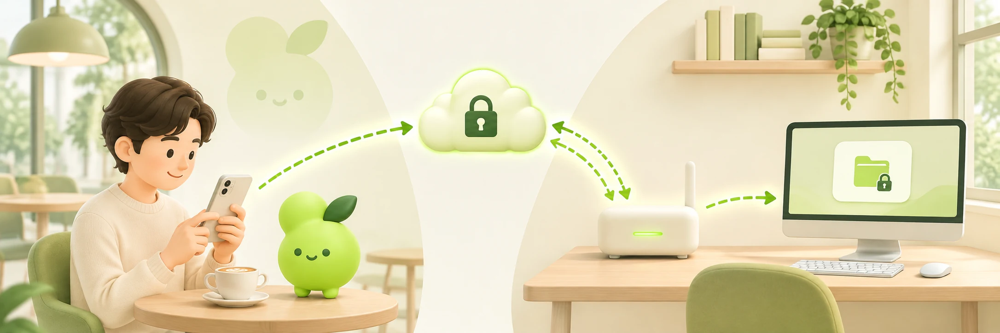

[原始 PNG](../../output/imagegen/18-remote.png) · [完整提示词](prompts/18-remote.txt)

设计用途：软件/网关目标体验讨论；尚无产品运行证据。

## 图 19

**网关在家庭 Linux NAS 的部署** · P2 · 请求模型 gpt-image-2.5-flare

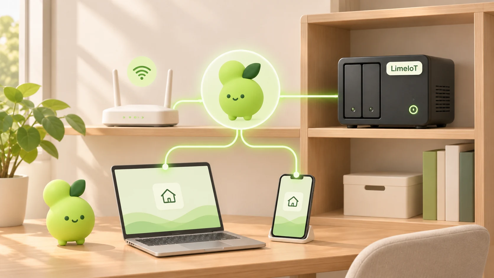

[原始 PNG](../../output/imagegen/19-gateway-deployment.png) · [完整提示词](prompts/19-gateway-deployment.txt)

设计用途：软件/网关目标体验讨论；尚无产品运行证据。

## 图 20

**撤销授权与私密空间** · P2 · 请求模型 gpt-image-2.5-sunburst

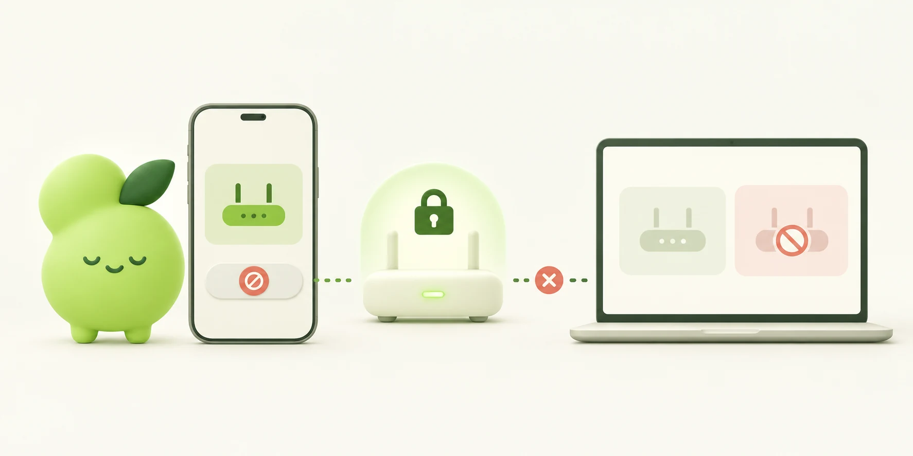

[原始 PNG](../../output/imagegen/20-privacy-revoke.png) · [完整提示词](prompts/20-privacy-revoke.txt)

设计用途：软件/网关目标体验讨论；尚无产品运行证据。

## 图 21

**桌面硬件与手机电脑联动** · P5 · 请求模型 gpt-image-2.5-flare

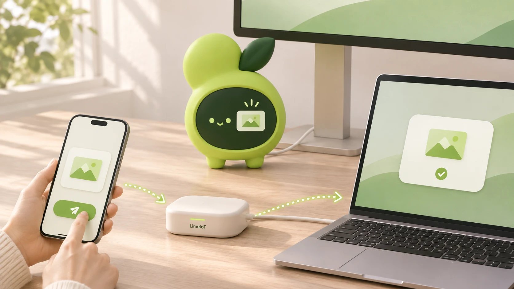

[原始 PNG](../../output/imagegen/21-hardware-desk.png) · [完整提示词](prompts/21-hardware-desk.txt)

设计用途：未来硬件生活场景探索，尚未成为工程规格或已冻结需求。

## 图 22

**学习与专注陪伴** · P5-exploration · 请求模型 gpt-image-2.5-flare

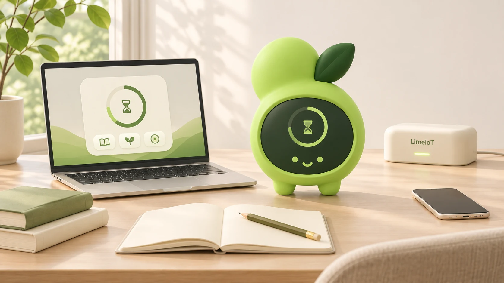

[原始 PNG](../../output/imagegen/22-hardware-study.png) · [完整提示词](prompts/22-hardware-study.txt)

设计用途：未来硬件生活场景探索，尚未成为工程规格或已冻结需求。

## 图 23

**床头提醒与静音** · P5-exploration · 请求模型 gpt-image-2.5-flare

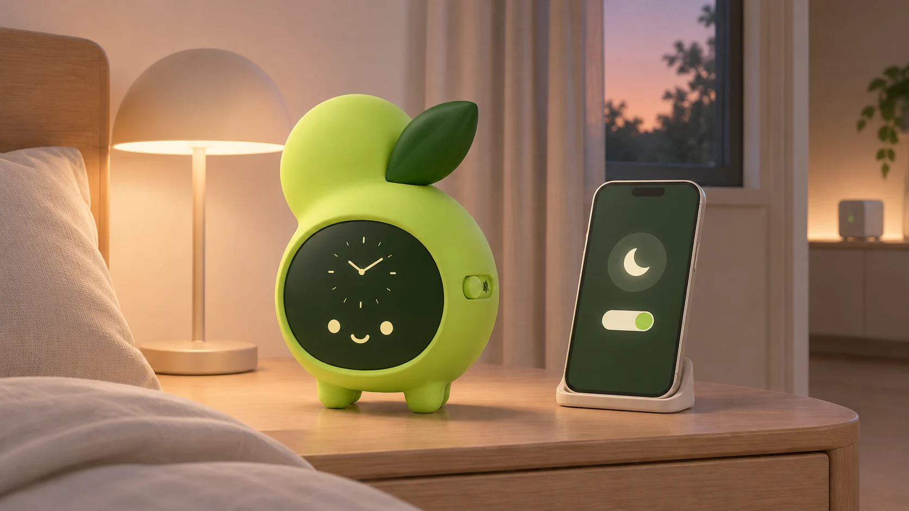

[原始 PNG](../../output/imagegen/23-hardware-bedside.png) · [完整提示词](prompts/23-hardware-bedside.txt)

设计用途：未来硬件生活场景探索，尚未成为工程规格或已冻结需求。

## 图 24

**家庭留言与厨房餐桌** · P5-exploration · 请求模型 gpt-image-2.5-flare

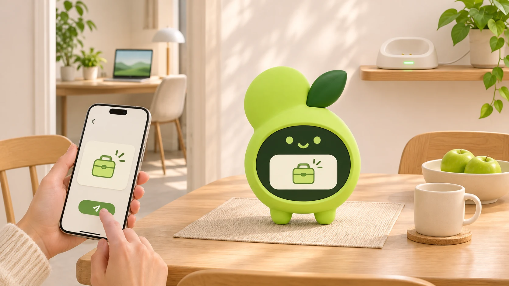

[原始 PNG](../../output/imagegen/24-hardware-family.png) · [完整提示词](prompts/24-hardware-family.txt)

设计用途：未来硬件生活场景探索，尚未成为工程规格或已冻结需求。

## 图 25

**会议桌协同与显式分享** · P5-exploration · 请求模型 gpt-image-2.5-flare

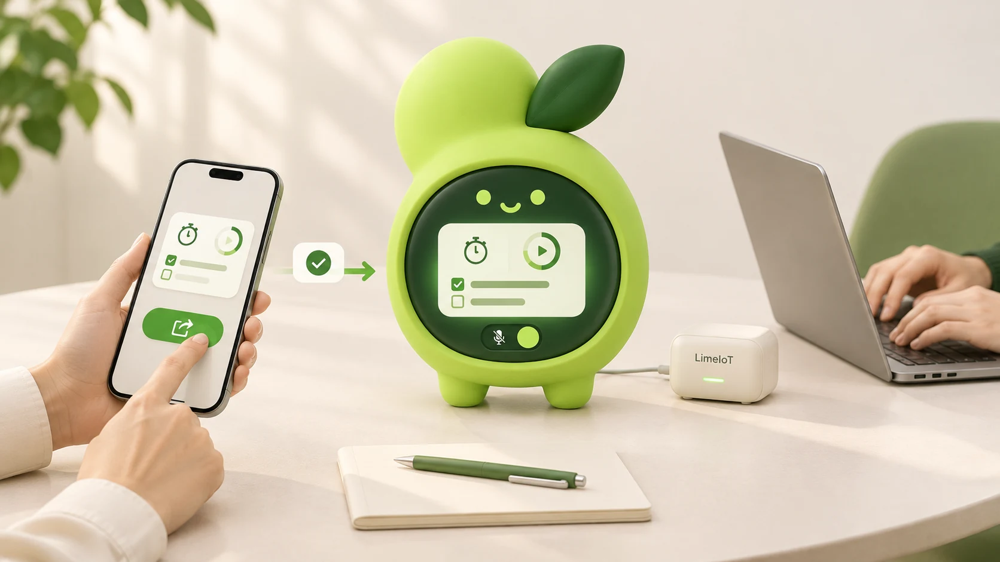

[原始 PNG](../../output/imagegen/25-hardware-meeting.png) · [完整提示词](prompts/25-hardware-meeting.txt)

设计用途：未来硬件生活场景探索，尚未成为工程规格或已冻结需求。

## 图 26

**差旅与便携场景候选** · P5-exploration · 请求模型 gpt-image-2.5-flare

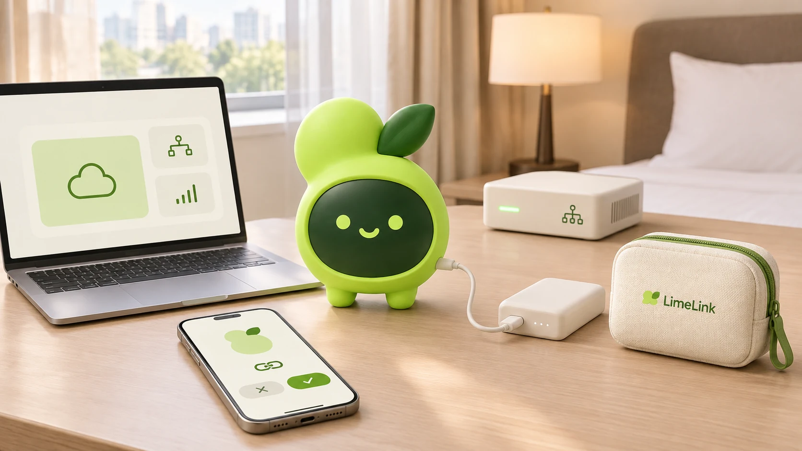

[原始 PNG](../../output/imagegen/26-hardware-portable.png) · [完整提示词](prompts/26-hardware-portable.txt)

设计用途：未来硬件生活场景探索，尚未成为工程规格或已冻结需求。

## 图 27

**大字号与可访问提醒** · P5-exploration · 请求模型 gpt-image-2.5-flare

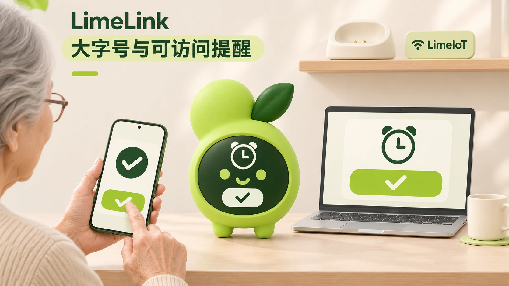

[原始 PNG](../../output/imagegen/27-hardware-accessible.png) · [完整提示词](prompts/27-hardware-accessible.txt)

设计用途：未来硬件生活场景探索，尚未成为工程规格或已冻结需求。

## 图 28

**硬件离线与恢复状态** · P5-exploration · 请求模型 gpt-image-2.5-flare

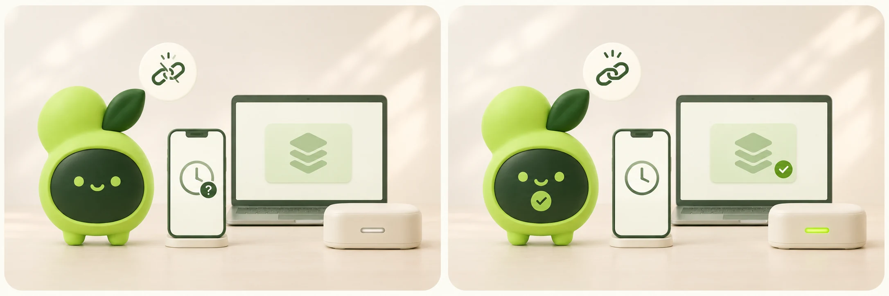

[原始 PNG](../../output/imagegen/28-hardware-offline.png) · [完整提示词](prompts/28-hardware-offline.txt)

设计用途：未来硬件生活场景探索，尚未成为工程规格或已冻结需求。
